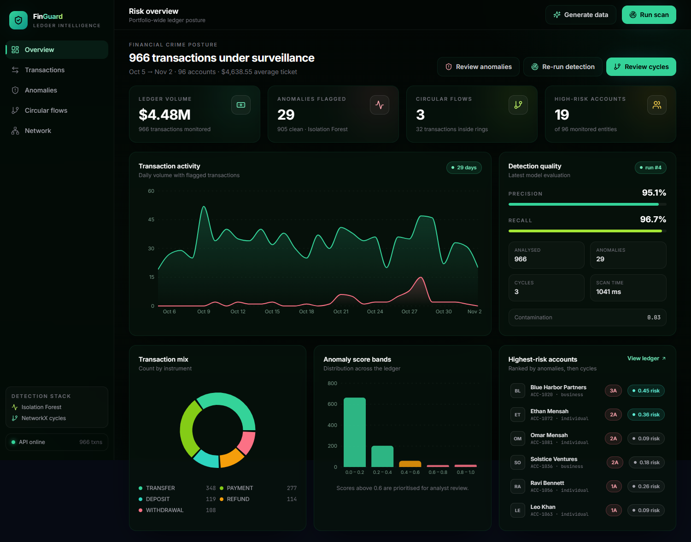
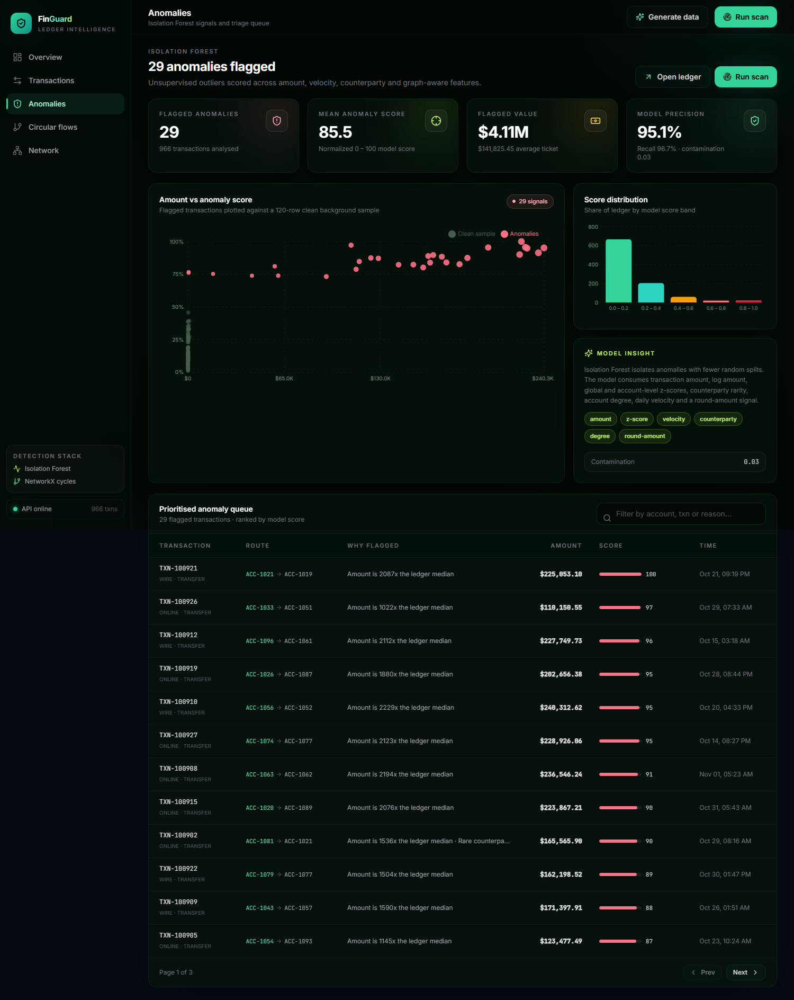
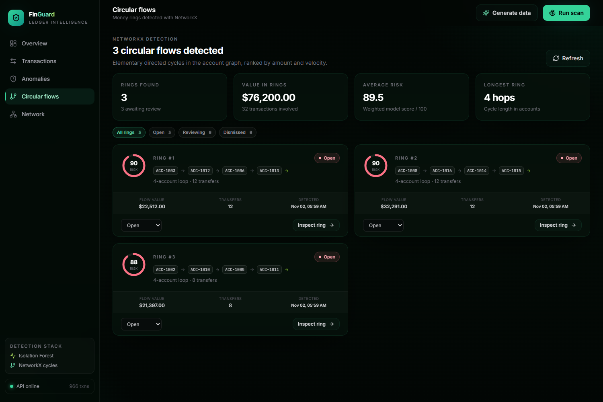
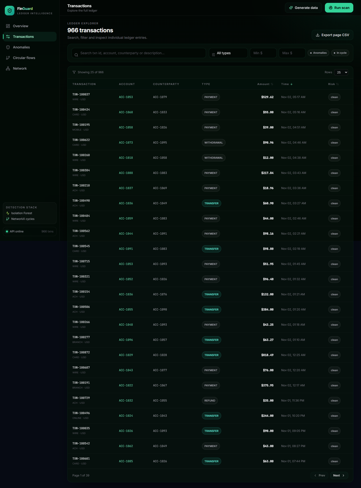
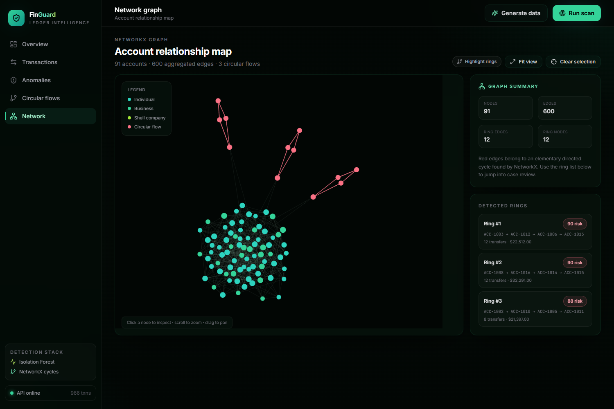

# FinGuard — Financial Ledger Anomaly & Cycle Detection

A full-stack platform that generates realistic synthetic ledgers, detects **statistical anomalies with Isolation Forest**, and finds **circular money flows with NetworkX** — all surfaced through an interactive React dashboard.



---

## What it does

| Capability | Implementation |
|---|---|
| **Anomaly detection** | `scikit-learn` Isolation Forest over amount, log-amount, global/account z-scores, counterparty rarity, in/out degree, daily velocity and round-amount signals. |
| **Cycle detection** | `NetworkX` directed account graph, SCC pruning, bounded elementary-cycle enumeration, per-ring risk scoring. |
| **Synthetic ledger** | Accounts (individual / business / shell), acyclic background transfer graph, high-value outliers, multi-round circular rings, ring funding edges. |
| **Analyst workflow** | Filterable transaction explorer, anomaly triage queue, ring review drawer with status workflow (`open → reviewing → dismissed`), force-directed network graph. |
| **Evaluation** | Precision / recall against the generator's synthetic ground truth. Demo seed: **0.95 precision · 0.97 recall**. |

### Screens

| Anomalies | Circular flows |
|---|---|
|  |  |

| Transactions | Network |
|---|---|
|  |  |

---

## Architecture

```
┌─────────────────────────────┐        ┌──────────────────────────────────┐
│  React 18 + Vite + Tailwind │  /api  │  FastAPI (Python)                │
│  Recharts · ForceGraph2D    │ ─────▶ │  SQLAlchemy · SQLite             │
│  React Router · Axios       │        │                                  │
└─────────────────────────────┘        │  ml/anomaly.py  IsolationForest  │
                                       │  ml/cycles.py   NetworkX         │
                                       │  data_gen.py    synthetic ledger │
                                       └──────────────────────────────────┘
```

### Backend layout

```
backend/
├── app/
│   ├── main.py          # REST endpoints
│   ├── models.py        # Account, Transaction, Cycle, DetectionRun
│   ├── schemas.py       # Pydantic request/response contracts
│   ├── crud.py          # Queries + dashboard aggregations
│   ├── services.py      # Detection orchestration & persistence
│   ├── data_gen.py      # Synthetic ledger generator
│   ├── database.py      # SQLite / SQLAlchemy session
│   └── ml/
│       ├── anomaly.py   # Isolation Forest feature engineering + scoring
│       └── cycles.py    # NetworkX cycle enumeration + risk scoring
├── tests/               # pytest API + ML tests
├── smoke_test.py        # End-to-end API smoke script
└── requirements.txt
```

### Frontend layout

```
frontend/src/
├── pages/          Dashboard · Transactions · Anomalies · Cycles · Network
├── components/     Layout · StatCard · Badge · GenerateModal · TransactionModal
├── context/        AppContext (generation, scans, toasts, refresh)
├── services/       Axios API client + formatters
└── index.css       Tailwind design system
```

---

## Quick start

**Prerequisites:** Python 3.11+ and Node 18+.

### 1. Backend

```powershell
cd backend
python -m venv .venv
.venv\Scripts\activate          # macOS/Linux: source .venv/bin/activate
pip install -r requirements.txt
uvicorn app.main:app --reload --port 8000
```

API docs: <http://localhost:8000/docs>

### 2. Frontend

```powershell
cd frontend
npm install
npm run dev
```

Open <http://localhost:5173>. The Vite dev server proxies `/api` to `localhost:8000`.

### 3. Seed the demo

Click **Generate data** in the top bar (preset *Demo*), or call the API:

```powershell
$body = @{
  n_accounts = 96; n_transactions = 900; n_anomalies = 28
  n_rings = 3; ring_size = 4; seed = 42; run_detection = $true
} | ConvertTo-Json

Invoke-RestMethod -Method Post -Uri http://localhost:8000/api/v1/generation/generate `
  -ContentType "application/json" -Body $body
```

Or run both servers with the helper script:

```powershell
.\start-dev.ps1
```

---

## API reference

| Method | Endpoint | Description |
|---|---|---|
| `GET` | `/api/v1/health` | Service + DB status |
| `GET` | `/api/v1/stats` | KPIs, trend, type mix, score bands, top accounts, latest run |
| `GET` | `/api/v1/transactions` | Paginated ledger (`page`, `page_size`, `search`, `txn_type`, `anomaly_only`, `cycle_only`, `min_amount`, `max_amount`, `sort`, `order`) |
| `GET` | `/api/v1/transactions/{txn_id}` | Single transaction |
| `POST` | `/api/v1/generation/generate` | Regenerate synthetic ledger, optionally run detection |
| `POST` | `/api/v1/detection/run` | Run Isolation Forest + NetworkX (`{"contamination": 0.03}`) |
| `GET` | `/api/v1/cycles` | Detected rings, optional `status` filter |
| `GET` | `/api/v1/cycles/{id}` | Ring path + member transactions |
| `PATCH` | `/api/v1/cycles/{id}/status` | `open` / `reviewing` / `dismissed` |
| `GET` | `/api/v1/graph` | Aggregated nodes + edges for the network view |

---

## How the models work

### Isolation Forest (`app/ml/anomaly.py`)

Features per transaction:

- raw amount and `log1p(amount)`
- global amount z-score and per-account amount z-score
- counterparty frequency (rare relationships score higher)
- account out-degree and counterparty in-degree
- transactions per account per day (velocity)
- round-amount flag (`amount % 100 == 0`)

The forest (`250` trees, `contamination=0.03` by default) produces a decision score; scores are min-max normalized to `0–1` so higher means more anomalous, and every flagged transaction receives a human-readable reason (amount multiple of median, spend outlier, velocity burst, rare counterparty, structuring signal).

### NetworkX (`app/ml/cycles.py`)

1. Build a directed graph: account → counterparty.
2. Restrict search to strongly connected components of size ≥ 2.
3. Enumerate elementary cycles with `nx.simple_cycles(..., length_bound=10)`, capped at 60 rings.
4. Deduplicate by canonical rotation, aggregate ring amount / transfer count / roundness.
5. Score risk from amount, ring size, velocity and round-amount ratio.
6. Tag every participating transaction with the persisted cycle id.

### Synthetic fraud patterns (`app/data_gen.py`)

- Background transfers follow a rank ordering, keeping the normal graph acyclic.
- ~18% of accounts are offshore **shell companies**.
- Injected outliers: `$38k–$245k` transfers against a `$12–$24k` normal ceiling.
- Rings: 3–8 shell accounts, 2–3 rounds, `$1.1k–$3.9k` per hop, plus one-way funding edges from legitimate accounts so rings are visible in the network graph without creating false cycles.

---

## Testing

```powershell
cd backend
python -m pytest tests -q
python smoke_test.py          # full API smoke run
```

```powershell
cd frontend
npm run build                 # production build
npm run e2e                   # Playwright UI check (Chrome required)
```

Latest verified results:

- **10 pytest tests passed** (API + Isolation Forest + NetworkX).
- **Smoke test:** 966 transactions, 29 anomalies, 3 rings, precision `0.9508`, recall `0.9667`.
- **Playwright:** dashboard, transactions, anomaly queue, cycles + drawer, network canvas, generate modal, scan toast — **0 console errors**.

---

## Notes

- The database is SQLite (`backend/ledger.db`) and is recreated automatically on first run. Set `DATABASE_URL` to point elsewhere.
- Detection runs synchronously — 966 transactions scan in ~1 second on a laptop.
- The ground-truth flag (`is_fraud_truth`) exists only because the ledger is synthetic; it is used solely to report precision/recall.
